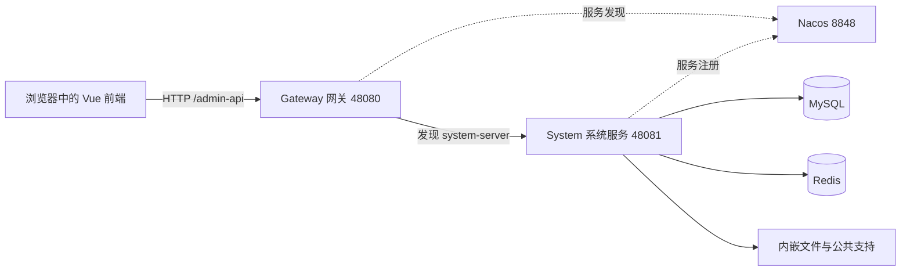
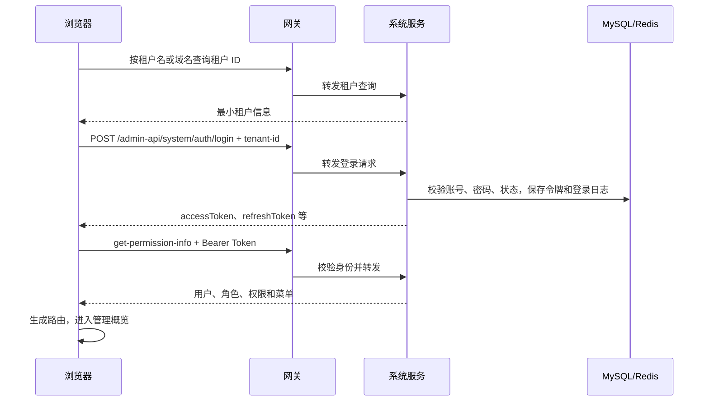
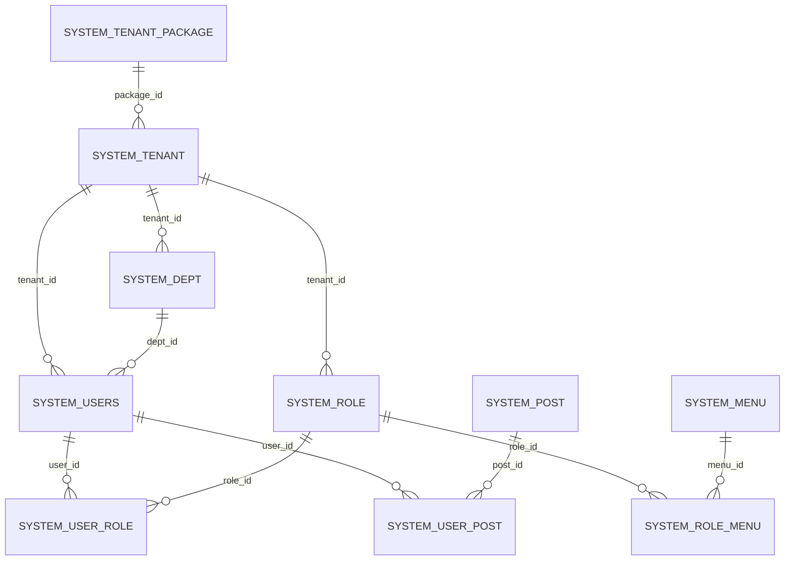
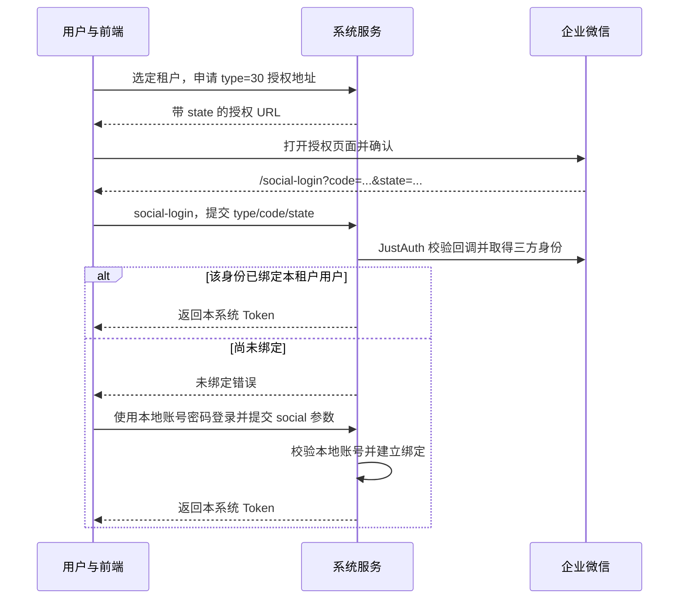
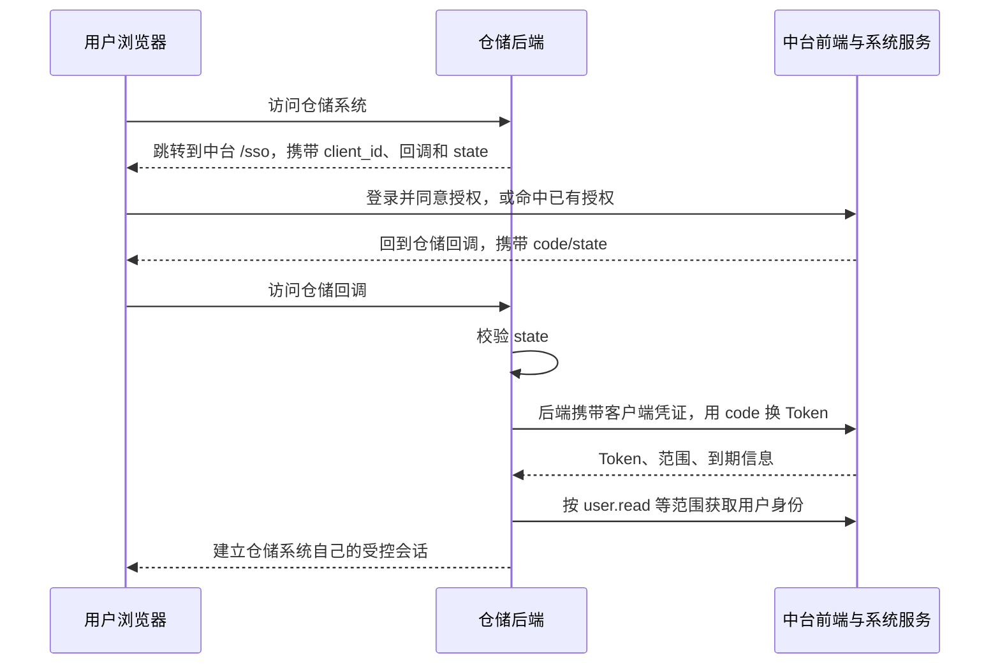

# 安天智能物流系统 · 系统中台后端

本仓库为 `antian-cloud`，本文对应 **`master-jdk17-base-system`** 分支。它提供统一的登录、组织、用户、角色、菜单、租户和权限服务，供管理后台以及以后接入的仓储等业务系统使用。

可以把它理解为公司的“统一用户中心”：业务系统负责入库、出库等业务；中台负责识别“你是谁、属于哪个公司、能做什么、能看哪些数据”。**当前分支已经精简为系统服务、网关和公共代码，不包含仓储、商城、会员、工作流等业务模块。**

配套前端：`antian-ui-admin-vue3`，分支 `master-base-system`。两个仓库应配套使用。本文依据当前代码编写；标为“接入示例”“后续设计”的内容需要开发后才能使用。

## 阅读导航

- [1. 先认识整个系统](#1-先认识整个系统)
- [2. 技术栈与版本](#2-技术栈与版本)
- [3. 目录和每个模块的作用](#3-目录和每个模块的作用)
- [4. 本地运行从这里开始](#4-本地运行从这里开始)
- [5. 一次请求怎样到达数据库](#5-一次请求怎样到达数据库)
- [6. 租户和组织账号如何设计](#6-租户和组织账号如何设计)
- [7. 权限如何设计](#7-权限如何设计)
- [8. 管理员怎样使用系统](#8-管理员怎样使用系统)
- [9. 企业微信授权登录](#9-企业微信授权登录)
- [10. 新仓储系统如何接入中台](#10-新仓储系统如何接入中台)
- [11. 开发一个接口的步骤](#11-开发一个接口的步骤)
- [12. 部署到服务器](#12-部署到服务器)
- [13. 测试验收和发布回退](#13-测试验收和发布回退)
- [14. 常见问题排查](#14-常见问题排查)
- [15. 建议的学习顺序和代码入口](#15-建议的学习顺序和代码入口)

## 1. 先认识整个系统

### 1.1 当前可以做什么

| 能力                                                   | 当前情况                                                 |
| ------------------------------------------------------ | -------------------------------------------------------- |
| 登录、退出、刷新令牌、个人资料                         | 已有代码；短信等登录方式还需配置对应供应商               |
| 管理概览                                               | 已有组织、人员、角色及操作统计；按权限读取实际数据       |
| 租户、套餐、用户、角色、菜单、部门、岗位               | 系统管理核心能力                                         |
| 字典、通知、站内信、短信、邮件、日志、OAuth2、三方登录 | 代码保留；菜单是否出现取决于角色和套餐，外部渠道需要配置 |
| 文件上传、文件读取、配置读取、API 日志、WebSocket      | 作为系统服务的内嵌公共支持保留                           |
| 仓储、订单、运输、财务、商城、工作流等业务             | 当前分支不包含；需要另行接入                             |
| 企微通讯录同步、自动入离职、按企微部门自动授权         | 后续设计，当前没有完整实现                               |

“代码存在”“页面可见”“第三方服务可用”是三件事。比如保留了短信代码，不代表未配置短信账号就能发送真实短信。

### 1.2 只有两个需要启动的 Java 应用



- **前端**：页面、表单和按钮，在浏览器里运行。
- **网关**：统一 API 入口、路由、跨域处理、令牌身份传递。
- **系统服务**：执行业务校验和权限检查，读取数据库。
- **MySQL**：长期保存用户、角色、菜单、租户、令牌和日志。
- **Redis**：缓存、令牌缓存、验证码和授权状态等临时数据。
- **Nacos**：告诉网关“系统服务现在在哪个地址”。本分支使用它进行服务发现，配置文件从本地 YAML 加载。

`module` 是 Maven 的代码分组，**不等于一个需要单独启动的服务**。例如 `antian-common` 会打进其他应用，自己没有启动端口。

## 2. 技术栈与版本

以下为当前 POM 中的主要版本，升级时以 [pom.xml](pom.xml) 和 [antian-dependencies/pom.xml](antian-dependencies/pom.xml) 为准。

| 技术                   | 当前版本或选择                                           | 用途                               |
| ---------------------- | -------------------------------------------------------- | ---------------------------------- |
| Java                   | 编译目标 17；本机运行配置使用 JDK 21                     | 后端开发语言和运行环境             |
| Maven                  | 建议 3.9.x                                               | 下载依赖、编译、测试、打包         |
| Spring Boot            | 3.5.15                                                   | 应用启动与自动配置                 |
| Spring Cloud           | 2025.0.1                                                 | 微服务基础能力                     |
| Spring Cloud Alibaba   | 2025.0.0.0                                               | Nacos 等组件适配                   |
| Spring Cloud Gateway   | 随 Cloud BOM 管理                                        | 基于 WebFlux 的网关                |
| Spring Security        | 随 Boot BOM 管理                                         | 登录身份、接口权限校验             |
| MyBatis / MyBatis Plus | 3.5.19 / 3.5.17                                          | Java 与 SQL 的映射、分页、逻辑删除 |
| MyBatis Plus Join      | 1.5.9                                                    | 关联查询辅助                       |
| MySQL                  | 本地使用 3306；建议新环境使用 MySQL 8.x 并验证初始化脚本 | 关系型数据库                       |
| Redis / Redisson       | Redisson 4.8.0                                           | 缓存、Redis 操作等                 |
| Nacos                  | 使用与当前 Cloud Alibaba 客户端兼容的服务端              | 服务注册和发现                     |
| OpenFeign              | 随 Cloud BOM 管理                                        | 服务之间调用 Java API              |
| JustAuth               | 1.16.7；Starter 1.4.0                                    | 企业微信等三方身份授权             |
| Lombok / MapStruct     | 1.18.48 / 1.7.0.Beta2                                    | 减少样板代码、对象转换             |
| Springdoc / Knife4j    | 随项目依赖管理                                           | API 文档和调试                     |

BOM 中还可能存在历史业务组件的版本管理。**存在版本号不代表当前分支启动了该业务或需要安装该中间件。** 最小本地链路先准备 MySQL、Redis、Nacos 即可；消息渠道、任务调度等按实际需要配置。

## 3. 目录和每个模块的作用

```text
antian-cloud/
├─ pom.xml                         Maven 根聚合工程
├─ antian-dependencies/             公共依赖版本清单 BOM
├─ antian-framework/                公共工具和 Spring Boot Starter
├─ antian-module-system/
│  ├─ antian-module-system-api/      对外服务接口、DTO、枚举
│  └─ antian-module-system-server/   系统管理的可执行应用
├─ antian-gateway/                  网关的可执行应用
├─ sql/mysql/init-system.sql        新空库初始化脚本
├─ script/jenkins/Jenkinsfile       两个服务的 Jenkins 部署流水线
└─ .idea/runConfigurations/         IDEA 共享运行配置
```

### 3.1 业务模块

| 模块                          | 做什么                                                                  | 是否单独启动  |
| ----------------------------- | ----------------------------------------------------------------------- | ------------- |
| `antian-dependencies`         | 统一第三方依赖和内部模块版本，避免各模块互相冲突                        | 否            |
| `antian-framework`            | 聚合下面的公共组件                                                      | 否            |
| `antian-module-system-api`    | 定义用户、部门、权限等 RPC 契约；其他服务依赖它，而不是依赖系统服务实现 | 否            |
| `antian-module-system-server` | 登录、租户、用户、角色、菜单、组织、消息、日志、OAuth2 等实现           | **是，48081** |
| `antian-gateway`              | 接收前端请求，将请求转到正确服务                                        | **是，48080** |

### 3.2 公共框架的 17 个子模块

| `antian-framework` 下的模块                      | 初学者理解                                                       |
| ------------------------------------------------ | ---------------------------------------------------------------- |
| `antian-common`                                  | 通用返回值、异常、工具、枚举及少量公共 RPC 契约                  |
| `antian-spring-boot-starter-env`                 | 环境标签等支持，让同环境服务正确发现彼此                         |
| `antian-spring-boot-starter-mybatis`             | 数据源、MyBatis Plus、分页、逻辑删除等数据库基础设置             |
| `antian-spring-boot-starter-redis`               | Redis 访问与缓存基础设置                                         |
| `antian-spring-boot-starter-web`                 | HTTP、统一异常、参数处理、API 日志等 Web 基础能力                |
| `antian-spring-boot-starter-security`            | 将令牌转成登录用户，提供 `@ss` 权限表达式和 RPC 身份传递         |
| `antian-spring-boot-starter-websocket`           | 服务器向在线浏览器推送消息的基础能力                             |
| `antian-spring-boot-starter-monitor`             | 监控、链路及运行状态相关支持                                     |
| `antian-spring-boot-starter-protection`          | 限流、防重复提交等防护支持；是否启用看实际依赖和配置             |
| `antian-spring-boot-starter-job`                 | 定时任务接入；本地 XXL-JOB 调度默认关闭                          |
| `antian-spring-boot-starter-mq`                  | 消息发送、消费以及上下文传递的公共封装                           |
| `antian-spring-boot-starter-rpc`                 | 声明式 RPC 的公共依赖入口；具体身份和租户拦截器在相应 Starter 中 |
| `antian-spring-boot-starter-excel`               | Excel 导入导出                                                   |
| `antian-spring-boot-starter-test`                | 测试数据库、测试基类等测试辅助                                   |
| `antian-spring-boot-starter-biz-tenant`          | 租户上下文、租户合法性校验、SQL 和缓存隔离                       |
| `antian-spring-boot-starter-biz-data-permission` | 部门、本人等行级数据权限                                         |
| `antian-spring-boot-starter-biz-ip`              | IP 地址相关能力                                                  |

这些组件是“可复用零件”，并非都需要外部服务。根工程总共聚合 24 个 Maven 工程，真正运行的仍是两个应用。

### 3.3 系统服务内部按什么顺序读

```text
controller/admin/    对外 HTTP 接口，检查参数和操作权限
service/             业务规则与事务，例如创建租户时同时创建管理员
dal/mysql/           Mapper，把查询交给数据库
dal/dataobject/      DO，数据库记录在 Java 中的样子
dal/redis/           Redis 缓存读写
convert/             VO、DTO、DO 的对象转换
api/                 系统服务实现对其他服务提供的 RPC 接口
framework/           本服务专用的安全、权限和三方登录配置
```

- **VO**：与页面通信的输入或输出；不要把密码散列等数据库字段直接返回给页面。
- **DTO**：服务间传递的数据。
- **DO**：数据库表的映射。
- **Controller → Service → Mapper**：先接收请求，再处理规则，最后读写数据库。

### 3.4 为什么精简分支里还有 `module.infra`

文件、配置读取、API 日志和 WebSocket 等基础能力仍被系统管理使用，因此最小实现内嵌进系统服务。它们保留 `com.group.antian.module.infra` 包名，以及 `/admin-api/infra/file/**` 等兼容路径。

部分文件存储配置会在数据库中保存实现类名。随意重命名这些包，会导致旧配置反序列化失败。**本分支没有独立的 `infra-server`，也不需要另启一个基础设施服务。** 普通基础设施管理业务页面已经精简。

## 4. 本地运行从这里开始

### 4.1 检查工具和分支

准备 Git、JDK 17 或 21、Maven 3.9.x、MySQL、Redis、Nacos，以及 IntelliJ IDEA。建议 IDEA 的 Project SDK、Maven Importer、Maven Runner 使用同一个 JDK 21，Java 编译目标仍为 17。

在 PowerShell 中执行：

```powershell
Set-Location D:\code\antian-cloud
git branch --show-current
git status --short
java -version
mvn -version
```

当前分支应为 `master-jdk17-base-system`。如果已有未提交修改，先保留自己的工作，再切换分支；不要为了启动执行强制重置。`mvn -version` 显示的 Java 也必须是 17 或 21，只有 IDEA 配对了 JDK、终端仍是 Java 8 时，命令行构建仍会失败。

本机已有 JDK 21 时，可在**当前终端**设置，其他电脑请替换真实安装路径：

```powershell
$env:JAVA_HOME = 'D:\soft\jdk-21\jdk-21'
$env:Path = "$env:JAVA_HOME\bin;$env:Path"
mvn -version
```

若 `mvn` 不存在，可以安装 Maven，或在 IDEA 的 Maven 工具窗口执行同样的生命周期。不要假设其他同学电脑具有相同的 `D:\soft` 路径。

### 4.2 必要依赖及本地地址

| 组件         | 本地地址           | 说明                                                     |
| ------------ | ------------------ | -------------------------------------------------------- |
| MySQL        | `127.0.0.1:3306`   | 库名 `ruoyi-vue-pro`；本地示例账号 `root`、密码 `123456` |
| Redis        | `127.0.0.1:6379`   | 本地配置使用数据库 0，默认未填密码                       |
| Nacos        | `127.0.0.1:8848`   | 两个服务使用命名空间 ID `dev`、分组 `DEFAULT_GROUP`      |
| 系统服务     | `127.0.0.1:48081`  | 应用名 `system-server`                                   |
| 网关         | `127.0.0.1:48080`  | 应用名 `gateway-server`，前端 API 入口                   |
| 前端开发服务 | `http://localhost` | 默认端口 80，另见前端 README                             |

MySQL 和 Redis 的上述密码仅用于本地开发。实际服务地址和密码以自己的配置为准。Nacos 需要事先创建**命名空间 ID 为 `dev`** 的空间；只有显示名称叫 dev、实际 ID 是随机串时并不匹配。

安装这些组件后，按所用版本的启动方式启动它们。已有本机环境可直接复用，不需要重复安装。应用使用 Nacos 服务发现；本分支没有从 Nacos 拉取远程配置的 Starter，`spring.cloud.nacos.config` 的遗留配置字段不表示正在加载远程业务配置。

### 4.3 数据库：已有环境和全新环境分开处理

**情况 A：已有 `ruoyi-vue-pro` 数据库并已在使用。**

只核对连接地址、密码和表结构，不重新导入初始化脚本。已有租户、用户、角色和文件配置应继续保留。切换到精简分支不要求删除其他业务表。

**情况 B：第一次安装，数据库为空。**

先使用 MySQL 客户端连接：

```powershell
mysql -h 127.0.0.1 -P 3306 -u root -p
```

输入密码后，在 MySQL 客户端内执行以下 SQL。`SOURCE` 是 MySQL 客户端命令，不是 PowerShell 命令：

```sql
CREATE DATABASE IF NOT EXISTS `ruoyi-vue-pro`
  DEFAULT CHARACTER SET utf8mb4;
USE `ruoyi-vue-pro`;
SOURCE D:/code/antian-cloud/sql/mysql/init-system.sql;
```

也可在数据库工具里选择新建空库，执行 [sql/mysql/init-system.sql](sql/mysql/init-system.sql)。脚本包含 38 张系统及公共支持表和演示种子数据，**不是生产库的升级迁移脚本**。`INSERT IGNORE` 不会将已有数据自动升级为新版本。种子中还包含历史演示账号和资料；正式上线前应审查并清理非必要演示身份、绑定和渠道配置，不能将其直接视为正式组织数据。

必须留意种子与现有本机环境的区别：

| 场景                   | 登录租户名                     | 用户名                       | 本地示例密码   |
| ---------------------- | ------------------------------ | ---------------------------- | -------------- |
| 当前脚本创建的全新空库 | **安天源码**，平台租户 ID 为 1 | `admin`                      | `admin123`     |
| 之前已改名的本机数据库 | **安天集团**，平台租户 ID 为 1 | 以实际账号为准，例如 `admin` | 以实际密码为准 |

脚本中 `admin` 的 BCrypt 散列与 `admin123` 已作离线匹配核对；这不代表已经替你导入过新数据库。其他种子账号不要猜测密码。首次登录后，应通过管理功能维护租户显示名称、正式账号和密码，前端默认租户名同步调整；平台权限依据 ID 1，不依据名字判断。

可用以下只读查询确认租户名：

```sql
SELECT id, name, status, package_id, expire_time
FROM system_tenant WHERE deleted = 0;
```

不要把 Java 测试资源下的 H2 建表 SQL 当作 MySQL 初始化脚本；其中的双引号和 `GENERATED BY DEFAULT AS IDENTITY` 等语法不适用于这里的 MySQL。

### 4.4 核对配置文件

| 文件                                                                                                                          | 主要内容                                                |
| ----------------------------------------------------------------------------------------------------------------------------- | ------------------------------------------------------- |
| [系统服务 application.yaml](antian-module-system/antian-module-system-server/src/main/resources/application.yaml)             | 端口、框架、租户、系统分支开关、文件公共地址、WebSocket |
| [系统服务 application-local.yaml](antian-module-system/antian-module-system-server/src/main/resources/application-local.yaml) | 本地数据库、Redis、Nacos、验证码和三方渠道              |
| [网关 application.yaml](antian-gateway/src/main/resources/application.yaml)                                                   | 网关端口和路由                                          |
| [网关 application-local.yaml](antian-gateway/src/main/resources/application-local.yaml)                                       | 本地 Nacos 等配置                                       |

系统服务的数据源在 `spring.datasource.dynamic.datasource.master`；local 配置中还存在 slave 连接，修改连接信息时不要遗漏。Redis 在 `spring.data.redis`。

本地 `antian.captcha.enable=false` 方便联调；`antian.security.mock-enable=true` 是开发便利配置。**生产必须显式关闭 mock 登录**。本地第三方应用配置不能直接视为自己企业的正式配置，也不要把真实 Secret 写进新的 Git 提交。

### 4.5 在 IntelliJ IDEA 2025.3.1 运行

1. 打开仓库根目录的 `pom.xml`，作为 Maven 项目导入，等待依赖下载。
2. 设置 Project SDK 为 JDK 21，Maven 导入及运行 JDK 同步。确认 Lombok 注解处理正常。
3. 启动 MySQL、Redis 和 Nacos。
4. 使用共享运行配置 **`Antian Local`**，它组合了 **`Local System`** 和 **`Local Gateway`**。也可先运行 `Local System`，再运行 `Local Gateway`。
5. 查看两个控制台，确认没有启动异常；到 Nacos 的 `dev` 空间检查 `system-server` 实例是否健康。

如果 IDEA 没显示共享配置，可按下表手动创建 Spring Boot 运行配置：

| 项目              | 系统服务                                                                 | 网关                                                |
| ----------------- | ------------------------------------------------------------------------ | --------------------------------------------------- |
| Main class        | `com.group.antian.module.system.SystemServerApplication`                 | `com.group.antian.gateway.GatewayServerApplication` |
| Module            | `antian-module-system-server`                                            | `antian-gateway`                                    |
| Active profiles   | `local`                                                                  | `local`                                             |
| Working directory | 仓库根目录                                                               | 仓库根目录                                          |
| VM options        | `-Xms128m -Xmx512m -Dfile.encoding=UTF-8`                                | 同左                                                |
| Program arguments | `--server.address=127.0.0.1 --spring.cloud.nacos.discovery.ip=127.0.0.1` | 同左                                                |

本地绑定回环地址适合单机调试。多台机器部署时，服务注册 IP 要改为网关实际能访问的内网 IP。

### 4.6 使用命令行运行

在仓库根目录打包：

```powershell
mvn clean package '-DskipTests' '-Dfile.encoding=UTF-8'
```

`-DskipTests` 仅为先打包运行，不代表测试已经通过。PowerShell 中将包含点号的 Maven 参数整体加引号，避免被错误解析。

分别在两个终端运行，两个终端的当前目录都设为仓库根目录：

```powershell
java '-Dfile.encoding=UTF-8' -jar .\antian-module-system\antian-module-system-server\target\antian-module-system-server.jar --spring.profiles.active=local --server.address=127.0.0.1 --spring.cloud.nacos.discovery.ip=127.0.0.1
```

```powershell
java '-Dfile.encoding=UTF-8' -jar .\antian-gateway\target\antian-gateway.jar --spring.profiles.active=local --server.address=127.0.0.1 --spring.cloud.nacos.discovery.ip=127.0.0.1
```

IDEA 和终端二选一启动同一个服务，避免重复占用端口。停止终端应用使用 `Ctrl+C`。

### 4.7 判断是否真的运行成功

依次检查：

1. 系统服务启动，数据库和 Redis 无连接异常。
2. Nacos 显示系统服务健康，命名空间和注册 IP 正确。
3. 网关可通过下面的只读接口请求系统服务。
4. 启动前端，在 `http://localhost` 登录，进入“管理概览”。

```powershell
Invoke-RestMethod -Uri 'http://127.0.0.1:48080/admin-api/system/tenant/get-id-by-name?name=%E5%AE%89%E5%A4%A9%E9%9B%86%E5%9B%A2'
```

上述示例查询“安天集团”；全新种子库请改为实际租户名。成功响应的业务 `code` 为 0。查询不到租户不等于服务没启动，要先核对名字。

系统服务本地 Swagger UI 可访问 `http://127.0.0.1:48081/swagger-ui/index.html`。网关提供 `/admin-api/system/v3/api-docs` 到系统文档的重写路由；它不等于把全部静态 Swagger UI 资源都代理出来。生产接口文档应关闭或限制访问。

## 5. 一次请求怎样到达数据库

### 5.1 账号密码登录链路



密码采用 BCrypt 散列校验，数据库不保存可直接解密的明文密码。前端 `.env` 的默认账号只用于填表，不会在数据库中创建账号。

### 5.2 已登录后查询用户列表

以 `/admin-api/system/user/page` 为例：

1. 页面通过 Axios 发送 `Authorization: Bearer <access_token>` 和 `tenant-id`。
2. Gateway 清除客户端伪造的内部身份头；有令牌时通过系统内部令牌 API 校验并缓存身份，转成可信的 `login-user` 继续传递。
3. System 的安全过滤器建立当前登录上下文；租户过滤器校验身份所属租户、请求租户及租户状态。
4. Controller 检查 `system:user:query` 操作权限。
5. Service 处理查询规则，Mapper 查询 `system_users`。
6. 租户插件和已配置的数据权限规则约束 SQL；最终返回分页 VO。

网关不是所有授权的唯一检查点。**没有令牌或令牌无效时，网关仍可能转发请求，由系统接口决定是否必须登录。** 不要只在网关加检查而删掉服务端接口权限。

### 5.3 Token 保存在哪里，怎样到达子系统

| 位置                                | 保存内容                                             | 用途             |
| ----------------------------------- | ---------------------------------------------------- | ---------------- |
| 浏览器 localStorage                 | `ACCESS_TOKEN`、`REFRESH_TOKEN` 等，通过缓存工具封装 | 前端发请求和续期 |
| `system_oauth2_access_token`        | Access Token、用户、租户、客户端、到期时间等         | 服务端令牌记录   |
| `system_oauth2_refresh_token`       | Refresh Token 记录                                   | 续期             |
| Redis `oauth2_access_token:<token>` | 访问令牌缓存                                         | 减少数据库查询   |
| Gateway 本地缓存                    | 令牌对应的登录身份                                   | 减少内部校验请求 |

令牌由随机 UUID 字符串生成，**不是可以解析出用户信息的 JWT**。过期时间由 OAuth2 客户端配置决定，不应在前端写死。

浏览器发到网关的 Bearer Token，网关据此获取身份并转发；后端 Feign 调用通过 `LoginUserRequestInterceptor` 传 `login-user`，通过 `TenantRequestInterceptor` 传当前 `tenant-id`。这和“每一跳自动复制原始 Authorization”不同。异步任务或自建 HTTP 客户端也不会自动获得当前线程上下文，需要按场景显式处理。

内部头只能在可信服务网络中使用，业务服务及 `/rpc-api/**` 不应直接暴露到公网。外部系统应按第 10 节的 OAuth2 或受控 API 方案接入。

### 5.4 统一响应格式

```json
{
  "code": 0,
  "msg": "",
  "data": {
    "list": [],
    "total": 0
  }
}
```

`code=0` 是当前 Java `CommonResult` 的成功值；前端兼容 0 和 200。HTTP 状态为 200 时，JSON 里的 `code=403` 仍表示操作被拒绝，不能只看网络请求颜色判断成功。

## 6. 租户和组织账号如何设计

### 6.1 用一个公司例子理解

- **租户**：“安天物流”这样的独立客户或组织边界，数据不能随意被其他租户看到。
- **部门**：一个租户内部的总部、分公司、仓储部等组织树。
- **用户**：具体操作系统的账号，属于某个租户，可关联一个主部门和多个岗位。
- **岗位**：仓管员、财务主管等组织职位；岗位本身不自动授予接口权限。
- **角色**：仓储查询员、系统管理员等权限集合，一个用户可以分配多个角色。
- **菜单**：目录、页面和按钮权限点的定义。
- **租户套餐**：平台允许某租户使用哪些功能，是租户授权的上限。

“安天集团”下面的子公司可以建为部门，也可以建为独立租户：需要共享同一套账号组织、用部门数据范围限制时用部门；需要独立账号和更明确的数据隔离时用租户。当前没有一张专门的公司业务表，管理概览中的子公司数量按主组织直属子节点统计。

### 6.2 主要表关系



图中是业务关系，并不表示所有关系都依赖数据库外键强制约束。创建和更新主要通过 Service 保证一致性。

| 表                      | 关键字段和意义                                                   |
| ----------------------- | ---------------------------------------------------------------- |
| `system_tenant`         | 名称、联系人、绑定域名、`package_id`、到期时间、账号额度、状态   |
| `system_tenant_package` | 套餐包含的 `menu_ids`，用于限定租户可使用功能                    |
| `system_users`          | 用户名、密码散列、昵称、`dept_id`、`post_ids`、状态、`tenant_id` |
| `system_dept`           | `parent_id` 形成组织树，包含负责人、排序和状态                   |
| `system_post`           | 岗位名称、编码、排序和状态                                       |
| `system_role`           | 角色名、`code`、状态、数据范围及指定部门集合                     |
| `system_menu`           | `parent_id`、类型、路由、组件、权限字符串和显示设置              |
| `system_user_role`      | 用户与角色的多对多关系                                           |
| `system_role_menu`      | 角色与菜单/按钮权限的多对多关系                                  |
| `system_user_post`      | 用户与岗位关系；用户上也保存岗位集合，使用服务维护一致性         |

常见公共字段包括 `creator/create_time/updater/update_time/deleted`。`deleted` 是逻辑删除标记，不是每次删除都直接从磁盘消失。启用/停用状态在本项目通常为 `0=启用、1=停用`，不要凭直觉反着写。

### 6.3 创建租户的业务流程

平台账号先选择套餐，填写租户基本信息、管理员账号和密码。`TenantServiceImpl` 在事务中创建租户，切换到新租户上下文，创建 `tenant_admin` 角色、按套餐分配菜单，再创建管理员、关联角色，并回写租户管理员 ID。

以后修改套餐时，租户管理员角色按新套餐更新；其他角色超过套餐范围的菜单权限会被裁剪。仅手工插入 `system_tenant` 一行不等于完整创建租户。

## 7. 权限如何设计

### 7.1 四层规则一起生效

| 层次          | 回答的问题                       | 例子                                   |
| ------------- | -------------------------------- | -------------------------------------- |
| 身份认证      | 你是否已登录？                   | Token 有效，能够得到用户与原始租户     |
| 功能权限 RBAC | 你能做哪个操作？                 | 角色授予 `system:user:update`          |
| 租户隔离      | 你能进入哪个租户的数据空间？     | 普通租户不能用改请求头的方式查平台数据 |
| 行级数据权限  | 在当前租户内，你能看到哪些记录？ | 仅本人、部门及下级的数据               |

菜单可见性只是前端体验。即使按钮被隐藏，后端也必须拒绝无权限请求。反过来，能看到菜单也不代表一定拥有该页全部新增、导出或删除权限。

### 7.2 RBAC：用户通过角色获得权限

普通角色通过 `system_user_role → system_role_menu → system_menu.permission` 得到操作权限。多个角色的有效授权合并，套餐、角色状态和当前系统分支范围继续约束结果。

后端示例：

```java
@PreAuthorize("@ss.hasPermission('system:user:query')")
```

前端示例：

```vue
<el-button v-hasPermi="['system:user:create']">新增</el-button>
```

角色标识 `super_admin` 有超级管理员的特殊逻辑，`tenant_admin` 是租户管理员。**用户名 `superAdmin`、`super` 或昵称“超级管理员”本身都不会触发超级权限。** 不应为了开放一个接口就给用户分配全部业务权限。

### 7.3 平台租户管理的特别规则

见 `framework/security/core/TenantManagementPermission.java`。平台租户固定为**原始登录租户 ID 1**，名称可以修改。判断基于原始身份，不能靠 `visit-tenant-id` 切换绕过。

| 操作                     | 当前条件                                                          |
| ------------------------ | ----------------------------------------------------------------- |
| 租户列表、详情、简化列表 | 原始登录租户 ID 1，后台用户，并具有 `system:tenant:query`         |
| 新增租户                 | 同上身份，并具有 `system:tenant:create`                           |
| 编辑租户                 | 同上身份，并具有 `system:tenant:update`                           |
| 删除/批量删除租户        | 同上身份，并具有 `system:tenant:delete`                           |
| 导出租户                 | 同上身份，并具有 `system:tenant:export`                           |
| 租户套餐 `simple-list`   | 同租户查询条件，只返回启用套餐的精简数据供选择                    |
| 完整租户套餐管理         | 平台身份、`super_admin` 角色及对应 `system:tenant-package:*` 权限 |

因此，`superAdmin` 可以只持有系统管理角色，通过精确分配租户操作权限管理租户，而不必看到其他业务菜单。普通租户即使错误分配了同名权限，仍不满足平台身份条件。

`package_id=0` 的内置系统租户还受保护：允许维护名称、联系人、电话和域名；不允许修改套餐、额度、到期时间、状态，也不允许删除。套餐下拉中的系统套餐不是普通套餐表里必须补的一行“0”。

### 7.4 租户隔离和访问租户

- 用户、部门、角色等租户数据带 `tenant_id`，租户 Starter 在配置范围内为 SQL 加隔离条件。
- `TenantSecurityWebFilter` 会检查请求租户与登录身份是否匹配，并检查租户是否停用或到期。
- 平台“访问租户”是单独的受控能力，不等于变更原始登录身份，也不等于自动拥有租户管理权。
- `@TenantIgnore` 表示特定方法忽略租户过滤，**不表示匿名可用或拥有操作权限**。全局租户列表等接口仍必须检查平台权限。
- 原始 SQL、关联表、缓存、异步任务、导出和新增业务表都要逐项确认隔离。不要假设所有自写 SQL 自动安全。

### 7.5 行级数据范围

| `DataScopeEnum` 值 | 含义                 |
| ------------------ | -------------------- |
| 1                  | 当前租户内全部数据   |
| 2                  | 指定部门数据         |
| 3                  | 本部门数据           |
| 4                  | 本部门及下级部门数据 |
| 5                  | 本人数据             |

角色在 `data_scope` 和 `data_scope_dept_ids` 中保存范围。数据权限规则需要知道一张表的“部门字段”和“归属用户字段”。本分支已为用户表注册 `dept_id` 与 `id`，为部门表注册 `id`。

**不是给角色设置“仅本人”，所有新业务表就自动被过滤。** 仓储表要有合适的归属字段，并在 `DeptDataPermissionRuleCustomizer` 中注册，必要时增加仓库、货主等业务规则。权限校验、SQL 过滤、根据 ID 查询/修改/删除的归属检查要共同覆盖。

### 7.6 精简分支的菜单过滤

`antian.system-only=true` 使后端 `MenuServiceImpl` 只保留系统管理根节点及其后代；前端 `src/store/modules/permission.ts` 还会筛选系统根路由。管理概览等公共页面由前端静态路由提供。

这避免旧数据库中的商城等菜单指向已经删除的页面，但没有删除数据库里的历史菜单、角色或其他业务表。后续新增仓储菜单必须同时调整两端允许范围，见第 10 节。

## 8. 管理员怎样使用系统

### 8.1 建议的初始化顺序

1. 使用正确的租户名和管理员账号登录，进入“管理概览”。
2. 核对平台租户资料，维护正式的名称、联系人和域名。
3. 建立部门树，例如“集团 → 分公司 → 仓储部”。
4. 建立岗位，例如仓管员、班组长；岗位描述职位，不负责接口授权。
5. 建立角色，按实际工作配置页面、按钮和数据范围。
6. 创建用户，设置部门和岗位，再通过“分配角色”授权。
7. 用普通账号重新登录，实际验证能看什么、能操作什么。
8. 如需独立客户空间，由有权限的平台账号创建套餐和租户，再让新租户管理员维护本租户人员。

### 8.2 菜单如何配置才有效

目录用于分组；菜单对应页面；按钮对应权限点。前端组件路径、路由名和权限字符串都要与代码一致。创建菜单不会自动生成 Vue 页面或 Java 接口。

例如“用户管理”页面的查询、新增、修改、删除、导出是不同权限。只需要查用户的角色，不应一并勾选删除和角色分配。

### 8.3 管理概览的统计口径

- 概览需要同时拥有用户查询、部门查询和角色查询权限。
- 组织与人员按当前租户及配置的数据范围读取；人员、部门统计选取启用记录。
- “子公司”是主组织下直属组织节点数，不是所有租户数；角色数按当前租户的角色记录统计。
- “未分配角色”从当前可见人员的角色关联计算。
- 活动统计还需要 `system:operate-log:query`。账号开通根据用户创建时间，停用和权限变更根据已有成功操作日志统计，不代表所有外部业务系统的完整审计。
- 当前活动筛选只接入统一用户中心；新增仓储系统不会自动进入活动统计。

菜单没出现时先查角色与套餐；数据少时查租户和数据范围；提示无权限时查看具体请求，而不是立刻给账号超级管理员。

## 9. 企业微信授权登录

### 9.1 当前实现到哪一步

前端登录页已有“企业微信授权”图标，类型为 `30`；后端 `SocialTypeEnum.WECHAT_ENTERPRISE` 对应 JustAuth 的 `WECHAT_ENTERPRISE`。

当前已有：生成授权地址、企微回调处理、校验三方身份、绑定已有本地用户、已绑定用户换取本系统 Token，以及个人中心社交绑定相关页面。**这属于身份登录接入，不等于已完成企业通讯录、部门、人员、岗位和角色同步。**

当前配置过程是：先从 `justauth.type.WECHAT_ENTERPRISE` 构建默认请求，再用当前租户下启用的 `system_social_client` 配置覆盖 `clientId/clientSecret/agentId`。因此数据库覆盖不是完全替代默认请求类型的注册。

### 9.2 当前登录与绑定流程



主要接口为：

| 方法与路径，统一以 `/admin-api` 为前缀    | 作用                             |
| ----------------------------------------- | -------------------------------- |
| `GET /system/auth/social-auth-redirect`   | 生成第三方授权跳转地址           |
| `POST /system/auth/social-login`          | 用回调授权码尝试登录已绑定用户   |
| `POST /system/auth/login`，附 social 字段 | 本地密码验证成功后绑定该三方身份 |

`system_social_user` 保存三方身份，`system_social_user_bind` 保存本系统用户与三方身份的绑定，`system_social_client` 保存应用配置。JustAuth 的授权状态使用 Redis，当前配置前缀是 `social_auth_state:`。企微返回的授权码、企微平台凭证与本系统 `accessToken` 是不同数据，不能混用。

### 9.3 真正联调前要准备什么

1. 在自己的企业微信管理后台创建/选择适合的应用，取得 CorpID、AgentID 和应用 Secret。
2. 给测试人员配置应用可见范围，并按所用授权方式设置回调域名、可信域名及所需的网络配置。
3. 准备能完成域名验证、浏览器回调和服务端换取身份的测试环境；不要默认 `localhost` 就符合企业微信的接入要求。
4. 将 Secret 保存在后端配置或受控数据库配置中，不能写到 `VITE_*` 环境变量。
5. 核对当前租户的三方应用配置，确认回调仍保持租户、type、跳转目标和 state。
6. 先建好本地用户并绑定，再验证后续免密码登录。应用可见范围、用户启用状态和本地角色授权都要独立测试。

官方规范入口：[扫码登录链接](https://developer.work.weixin.qq.com/document/path/91039)、[网页授权链接](https://developer.work.weixin.qq.com/document/path/91022)、[获取访问用户身份](https://developer.work.weixin.qq.com/document/path/91023)。不同授权方式和控制台版本的域名、网络要求以企业微信当前官方说明为准；本文描述的实现依据仓库代码，不代表已经完成真实企业环境联调。

### 9.4 后续设计建议，尚未实现

建议将“企微证明身份”和“中台决定权限”分开：

| 后续能力       | 建议设计                                                                      |
| -------------- | ----------------------------------------------------------------------------- |
| 企业和租户映射 | 后端维护企业 CorpID、应用与 tenantId 的确定关系，不允许回调参数任意指定租户   |
| 稳定账号绑定   | 使用包含企业维度的稳定成员标识关联本地用户，不凭昵称或相同手机号直接授予身份  |
| 自动开户       | 如需要，采用审核或受限默认角色；首次企微登录不直接创建超级管理员              |
| 组织同步       | 单独的同步任务/事件处理，维护外部部门与本地部门映射、幂等和失败重试           |
| 离职处理       | 停用本地用户、撤销绑定和有效会话；验证各缓存的失效时效                        |
| 角色同步       | 显式维护企微组织与业务角色映射，岗位、部门与权限不做未经确认的自动等同        |
| 回调安全       | 校验一次性 state、回调域名和重定向白名单；减少授权码/Token 出现在日志中的机会 |
| 测试           | 覆盖未绑定、已停用、租户过期、重复回调、跨企业同名人员和登出后的访问          |

企业微信登录后仍使用同一套本地租户、RBAC 和数据权限，不能因为“企微已授权”就跳过本系统的权限检查。

## 10. 新仓储系统如何接入中台

这一节是**接入指南与开发示例**。当前分支没有 `antian-module-wms` 或对应页面，下面的服务名、端口和权限需要自行实现。

### 10.1 先选择接入方式

| 方式                                 | 适用场景                             | 主要工作                                               |
| ------------------------------------ | ------------------------------------ | ------------------------------------------------------ |
| 共用管理后台和网关，独立业务服务     | 团队希望用户在同一套后台操作仓储     | 增加 WMS 服务、路由、页面、菜单、权限与数据范围        |
| 独立仓储前后端，通过 OAuth2 单点登录 | 新仓库已有自己的系统，或需要独立发布 | 注册客户端、授权码换令牌、用户映射、业务授权和登出协同 |

两种方式都建议以中台用户 ID、租户 ID 为身份依据，避免每个子系统重复维护一套不一致的用户密码。仓库、货位、库存等业务数据由仓储服务负责。

### 10.2 同一后台接入 WMS 的步骤

1. 从当前系统基线创建业务集成分支，新增 `antian-module-wms-api` 和 `antian-module-wms-server`，在根聚合 POM 中声明。
2. 使用统一 BOM；按需依赖 web、security、mybatis、tenant、data-permission、rpc 等 Starter，以及 `antian-module-system-api`。
3. 设置应用名，例如 `wms-server`，端口例如 `48083`，注册到与网关一致的 Nacos 命名空间；明确主类扫描范围和 Feign 扫描范围。
4. 建立自己的数据库迁移脚本，业务表包含 `tenant_id`、审计字段，以及实际需要的部门/归属用户字段。不直接复用演示业务表。
5. 实现接口和事务，例如 `wms:stock:query`、`wms:receipt:create`，后端逐项校验权限。
6. 为仓储表注册部门/用户数据规则；涉及跨仓库、货主、单据审核时增加相应业务规则。
7. 增加网关路由，并确认生产网络只能从受控入口访问业务服务。
8. 前端增加 `src/api/wms`、`src/views/wms`，配置菜单、组件路径和按钮权限。
9. **同步调整后端 `MenuServiceImpl` 与前端 `src/store/modules/permission.ts` 的根菜单允许范围为 system、wms。** 不要直接关闭系统分支过滤，让所有历史菜单恢复，否则会出现指向已删除页面的菜单。
10. 平台为套餐加入 WMS 菜单；租户管理员再给本租户角色分配；用两个不同租户和不同数据范围的账号做隔离测试。

网关路由片段示例，放在现有 `spring.cloud.gateway.server.webflux.routes` 列表中：

```yaml
- id: wms-admin-api
  uri: grayLb://wms-server
  predicates:
    - Path=/admin-api/wms/**
```

如果业务服务继承了当前 Web 路径前缀约定，通常保留 `/admin-api/wms/**` 路径，不要未经核对就 StripPrefix。`grayLb` 是本项目已有的负载均衡约定，服务注册与环境标签要相匹配。

一个候选的入库链路为：浏览器 → 网关 → WMS Controller → 权限和租户校验 → WMS Service 事务 → 入库单/库存表 → 操作审计。需要人员名称等信息时通过系统 API 查询，不把跨服务查用户当作每个 SQL 的数据库联表。

### 10.3 独立系统通过 OAuth2 接入

当前保留 OAuth2 客户端、授权码、Token、授权记录和前端 `/sso` 授权页面，可作为接入基础。



具体步骤：

1. 有权限的平台管理员在 OAuth2 客户端管理中注册一个独立 clientId，配置受控回调 URL、授权范围、令牌有效期和客户端凭证。
2. 仓储后端生成并保存 state，浏览器跳转到中台前端，例如：

```text
https://platform.example.com/sso?client_id=wms&response_type=code&redirect_uri=https%3A%2F%2Fwms.example.com%2Fauth%2Fcallback&scope=user.read&state=<随机值>
```

3. 仓储后端回调校验后，以表单参数向 `POST /admin-api/system/oauth2/token` 请求 `grant_type=authorization_code`，携带 `code`、一致的 `redirect_uri`、`state`。**当前实现从 HTTP Basic Authorization 读取 clientId/clientSecret**，不是直接把 Secret 写进浏览器请求。
4. 使用返回令牌调用 `GET /admin-api/system/oauth2/user/get`，需要 `user.read` 范围；服务端校验、撤销和刷新接口参照 `OAuth2OpenController`。
5. 对照响应 VO 对接：本项目使用 `CommonResult` 包装，并有自己的字段命名，不能未经验证就宣称兼容所有通用 OAuth/OIDC SDK。当前没有完整 OIDC、PKCE 或跨应用单点登出成品方案。
6. 仓储系统仍需执行自身接口权限、租户和业务数据授权；OAuth2 scope 控制已显式声明 scope 的接口，**不是全部后台接口天然都有细分 scope**。

内网 Java 服务另可使用 `OAuth2TokenCommonApi` 和系统 API 契约；网关使用的是内部 `GET /rpc-api/system/oauth2/token/check`。它与供外部客户端认证后调用的 `POST /admin-api/system/oauth2/check-token` 是两条不同链路。不要把内部免登录 RPC 直接开放给外部仓库网络。

## 11. 开发一个接口的步骤

以新增“系统中的某个管理资源”为例：

1. 明确所属租户、谁拥有记录、哪些角色能查和改，先写清规则。
2. 写版本化数据库迁移，建立 DO 和 Mapper；不要用修改初始化脚本代替已有环境升级。
3. 写 Service 处理业务规则和事务，检查引用的用户、部门等确实属于允许范围。
4. 写请求/响应 VO 和 Controller，添加参数校验、操作权限与需要的日志。
5. 如需给其他服务调用，先在 api 模块定义 DTO 和接口，在 server 中实现。
6. 在菜单中配置页面和按钮权限，由角色、套餐授予需要的权限。
7. 接入前端并测试：有权限成功、无权限拒绝、跨租户拒绝、越过数据范围拒绝、导出范围一致。

新接口不要返回完整 DO，尤其不要返回密码、三方 Secret 和其他用户的 Token。复杂操作使用业务方法，不建议前端通过多个不受事务保护的请求手工拼接“创建租户及管理员”。

## 12. 部署到服务器

### 12.1 推荐拓扑和发布产物

简单单机部署可使用 Linux + Nginx + 两个 Java 进程，MySQL、Redis、Nacos 使用可达的受控实例。前端部署静态文件，Java 服务运行可执行 Jar。

```text
公网 HTTPS 域名
    └─ Nginx
       ├─ /                 前端静态资源
       ├─ /admin-api/        → Gateway 48080 → System 48081
       └─ /infra/ws          → Gateway 48080 → System WebSocket

内网：MySQL、Redis、Nacos、服务 RPC、监控端点
```

后端打包产物：

- `antian-module-system/antian-module-system-server/target/antian-module-system-server.jar`
- `antian-gateway/target/antian-gateway.jar`

以下路径、域名和配置均为**部署示例，需要在服务器自行创建**，不是仓库里已有的一键部署包。`example.com` 是占位域名。

### 12.2 外置生产配置

建议目录：

```text
/opt/antian/
├─ system/system-server.jar
├─ gateway/gateway-server.jar
├─ config/system/application-prod.yaml
├─ config/gateway/application-prod.yaml
└─ web/                         前端打包结果
```

系统服务的外置 `application-prod.yaml` 最小骨架如下。环境变量需要由部署平台、服务管理器或受控环境文件注入，不会凭空产生：

```yaml
server:
  address: 127.0.0.1
  port: 48081
spring:
  cloud:
    nacos:
      server-addr: ${NACOS_ADDR}
      username: ${NACOS_USERNAME:}
      password: ${NACOS_PASSWORD:}
      discovery:
        namespace: ${NACOS_NAMESPACE}
        group: DEFAULT_GROUP
        ip: ${SERVICE_IP:127.0.0.1}
  datasource:
    dynamic:
      primary: master
      datasource:
        master:
          driver-class-name: com.mysql.cj.jdbc.Driver
          url: ${DB_URL}
          username: ${DB_USERNAME}
          password: ${DB_PASSWORD}
    druid:
      stat-view-servlet:
        enabled: false
  data:
    redis:
      host: ${REDIS_HOST}
      port: ${REDIS_PORT:6379}
      password: ${REDIS_PASSWORD}
      database: 0
antian:
  system-only: true
  security:
    mock-enable: false
  captcha:
    enable: true
  file:
    public-base-url: ${ANTIAN_FILE_PUBLIC_URL}
xxl:
  job:
    enabled: false
springdoc:
  api-docs:
    enabled: false
  swagger-ui:
    enabled: false
management:
  endpoints:
    web:
      exposure:
        include: health,info
```

此示例以网关、系统服务和 Nginx 同机为前提；多机时，绑定地址和 `SERVICE_IP` 使用服务间可达的内网地址。数据库 URL 示例为 `jdbc:mysql://<内网地址>:3306/<库名>?serverTimezone=Asia/Shanghai&characterEncoding=utf8`，TLS 等连接选项按数据库部署要求设置。

网关的外置配置同样设置 `server.port=48080`、Nacos 地址、命名空间、凭证与注册 IP，并限制监控暴露。系统路由继续从包内 `application.yaml` 加载；若外置文件重新声明 routes 列表，要完整核对，避免覆盖丢失文件与 WebSocket 路由。

还要按需要补齐短信、邮件、企微、文件存储等配置。当前默认配置中有用于演示的渠道信息、短信验证码范围和监控开放设置：**上线应换成自己的受控配置，验证码不可继续固定为开发示例值，mock 必须关闭。** 未接通的渠道入口应在产品中禁用或隐藏，不能仅留下可点击但必失败的入口。

### 12.3 运行 Jar

环境变量就绪后，在 Linux 中分别启动：

```bash
java -Xms256m -Xmx1024m -Dfile.encoding=UTF-8 \
  -jar /opt/antian/system/system-server.jar \
  --spring.profiles.active=prod \
  --spring.config.additional-location=file:/opt/antian/config/system/
```

```bash
java -Xms128m -Xmx512m -Dfile.encoding=UTF-8 \
  -jar /opt/antian/gateway/gateway-server.jar \
  --spring.profiles.active=prod \
  --spring.config.additional-location=file:/opt/antian/config/gateway/
```

`additional-location` 保留包内基础配置并追加外置配置；`prod` 会选择对应的 `application-prod.yaml`。不要直接用 `local` profile 在公网运行。生产由 systemd、容器平台或 Jenkins 托管进程，配置重启策略、日志采集和启动顺序；不要仅依赖一个断开 SSH 就结束的终端。

默认应用日志位于运行用户的 `${user.home}/logs/system-server.log` 和 `gateway-server.log`。生产可以统一覆盖日志路径，确保运行账号有目录权限。

### 12.4 Nginx 和前端

前端先将生产 API 地址配置为同域，再构建，将 `dist-prod` **内部文件**放到 `/opt/antian/web/`。如果仍使用前端 `.env.prod` 当前的 `http://localhost:48080`，其他人的浏览器会请求他们自己电脑，部署一定不对。Vite 构建还会读取 `.env.local`，需在生产配置中显式设置验证码开关并与后端一致，同时覆盖开发默认账号和密码，具体步骤见前端 README。

以下 Nginx 片段放到已经配置好 TLS 的 `server` 内，证书和域名按实际环境配置：

```nginx
root /opt/antian/web;
index index.html;
client_max_body_size 32m;

location / {
    try_files $uri $uri/ /index.html;
}

location /admin-api/ {
    proxy_pass http://127.0.0.1:48080;
    proxy_set_header Host $host;
    proxy_set_header X-Forwarded-Proto $scheme;
    proxy_set_header X-Forwarded-For $proxy_add_x_forwarded_for;
}

location /infra/ws {
    proxy_pass http://127.0.0.1:48080;
    proxy_http_version 1.1;
    proxy_set_header Upgrade $http_upgrade;
    proxy_set_header Connection "upgrade";
    proxy_set_header Host $host;
    proxy_read_timeout 3600s;
}
```

`proxy_pass` 不加会替换路径的尾部 URI，保留 `/admin-api` 给网关。WebSocket 也要单独支持协议升级。网关中的 `DedupeResponseHeader` 不要随意删除；重复 CORS 响应头会造成“命令行请求成功，浏览器却 Network Error”。

文件上传后的公共地址由 `ANTIAN_FILE_PUBLIC_URL` 控制，生产设为浏览器可达的 HTTPS 域名，例如 `https://platform.example.com`。旧文件记录中的历史 URL 不会因为改环境变量自动全部重写，迁移时单独核对。

### 12.5 Jenkins、备份和多实例

仓库已有 [script/jenkins/Jenkinsfile](script/jenkins/Jenkinsfile)，按 `system-server`、`gateway-server` 两个任务进行 Maven 构建、SSH 部署、备份和启动检查。使用前先阅读文件头部的工具、凭据和服务器 `app.env` 要求，替换实际服务器、目录、环境信息；不要把密码直接写进流水线。

发布前备份数据库、文件配置及文件数据、应用 Jar 和外置配置。源码可回退不代表数据库结构会自动回退，迁移应尽量兼容上一版本。

目前 WebSocket 使用 `sender-type: local`。增加系统服务实例时，要评估跨实例通知、任务重复执行、缓存失效和文件存储共享；不能只复制一个 Jar 就视为完成高可用。Redis 清空会影响缓存和授权状态，不应把 `FLUSHALL` 当日常排障命令。

## 13. 测试验收和发布回退

### 13.1 开发自测

在依赖和测试环境就绪后执行：

```powershell
mvn test '-Dfile.encoding=UTF-8'
```

需要完整构建验证时执行 `mvn clean verify`。测试会验证各自测试环境中的规则，不能替代浏览器登录、真实 Nacos 路由以及企业微信联调。切勿将测试资源的数据源随意指向生产库。

### 13.2 每次发布至少验证这些业务

| 场景                                  | 应看到什么                                           |
| ------------------------------------- | ---------------------------------------------------- |
| 正常账号登录                          | 进入管理概览，读取符合权限的菜单和数据               |
| 错误密码、停用账号、停用/过期租户     | 拒绝登录或访问，不泄露其他账号信息                   |
| 只有查询权限的用户                    | 能查询，新增、编辑、删除、导出按各自权限拒绝         |
| 平台受限管理员                        | 获授权的租户操作可用；套餐完整管理仍受超级管理员约束 |
| 普通租户修改 tenant-id 或请求平台列表 | 拒绝跨租户访问                                       |
| 数据范围仅本部门/本人                 | 列表、详情、修改、导出保持一致范围                   |
| 文件上传与读取                        | 返回浏览器可访问地址，生产不是 localhost             |
| 刷新 Token、退出、权限变更            | 行为符合有效期和缓存失效策略                         |
| 企微授权                              | 分别覆盖已绑定、未绑定、回调失败等分支               |
| 精简后的导航                          | 没有指向已删除业务代码的菜单或 API 调用              |

回退时先确认数据库兼容性，再切换备份 Jar、静态资源和对应配置，重新验证登录与权限。不要为了恢复访问临时关闭租户隔离或放开全部 RPC 到公网。

## 14. 常见问题排查

| 现象                                        | 优先排查                                                                    |
| ------------------------------------------- | --------------------------------------------------------------------------- |
| `invalid target release: 17` 或类版本不兼容 | `mvn -version`、IDEA Maven Runner 和实际运行 Java 是否一致                  |
| Maven 命令把参数当成阶段/插件               | PowerShell 将 `-Dfile.encoding=UTF-8` 等参数整体加引号                      |
| MySQL 连接失败                              | 服务、3306、库名、master/slave 连接、用户名密码和授权                       |
| 表不存在                                    | 是否选择正确库、是否只导入了部分脚本；测试 H2 SQL 不能用于 MySQL            |
| Redis 连接失败                              | 地址、端口、密码、数据库号及网络                                            |
| 网关 503、找不到 system-server              | Nacos 命名空间 ID、服务健康、注册 IP、环境标签和网关到服务的网络            |
| 48080/48081 被占用                          | 是否 IDEA 与终端各启动了一份；先定位进程再处理                              |
| HTTP 200 但页面“没有操作权限”               | 查看 JSON 的业务 code 和具体 URL，再查角色、原始租户和对应权限              |
| 租户套餐下拉失败                            | `/tenant-package/simple-list` 需要平台租户查询权限；不是普通租户公共接口    |
| 平台账号有编辑权仍改不了部分字段            | 目标是否为 packageId=0 的内置系统租户，受保护字段不能修改                   |
| 有菜单但无数据                              | 租户、部门数据范围、筛选条件、账号/组织状态，不一定是接口坏了               |
| 新增菜单不显示                              | 系统分支双端过滤、套餐、角色菜单、组件路径和登录缓存                        |
| 浏览器 Network Error，curl 成功             | CORS 头是否重复、API 地址、HTTPS 混合内容、网关与 Nginx配置                 |
| 刷新页面 404                                | Nginx 是否配置 `try_files ... /index.html`                                  |
| 上传成功却看不到图片                        | 文件公共地址、网关文件路由、历史文件 URL 和存储权限                         |
| 企微跳转失败或授权码无效                    | 当前租户应用配置、回调编码、state、域名、可见范围、重复使用 code            |
| 改了配置无效果                              | 是否修改了实际激活的 profile，外置配置或环境变量是否覆盖，是否需要重启/重建 |

排查顺序建议是：**浏览器具体请求和响应 → 网关日志 → 系统日志 → Nacos/数据库/Redis**。保留请求时间和不含敏感信息的错误详情，不在截图或工单里发布完整 Token、密码和 Secret。

## 15. 建议的学习顺序和代码入口

第一天先跑通“登录 → 管理概览 → 用户查询”，用断点观察 Controller、Service、Mapper。然后创建一个只有查询权的角色，再用第二个租户验证隔离。理解这些以后再添加业务模块。

| 要研究的问题             | 代码入口                                                                             |
| ------------------------ | ------------------------------------------------------------------------------------ |
| 系统启动                 | `antian-module-system-server/.../SystemServerApplication.java`                       |
| 网关怎样查 Token、传身份 | `antian-gateway/.../filter/security/TokenAuthenticationFilter.java`                  |
| 登录、密码验证、三方绑定 | `system-server/.../service/auth/AdminAuthServiceImpl.java`                           |
| Token 创建、刷新、存储   | `system-server/.../service/oauth2/OAuth2TokenServiceImpl.java`                       |
| 用户、角色、菜单授权     | `system-server/.../service/user/`、`service/permission/`                             |
| 创建租户与管理员         | `system-server/.../service/tenant/TenantServiceImpl.java`                            |
| 平台租户操作边界         | `system-server/.../framework/security/core/TenantManagementPermission.java`          |
| 部门数据规则注册         | `system-server/.../framework/datapermission/config/DataPermissionConfiguration.java` |
| 管理概览的统计口径       | `system-server/.../service/dashboard/ManagementDashboardService.java`                |
| 企微应用配置和授权地址   | `system-server/.../service/social/SocialClientServiceImpl.java`                      |
| 外部系统 OAuth2 接入     | `system-server/.../controller/admin/oauth2/OAuth2OpenController.java`                |

表中 `system-server/.../` 的完整前缀为 `antian-module-system/antian-module-system-server/src/main/java/com/group/antian/module/system/`；网关前缀为 `antian-gateway/src/main/java/com/group/antian/gateway/`。搜索类名比逐级展开目录更快。

维护本文时同时核对配置、POM、SQL 和配套前端，尤其是登录租户名、端口、权限规则与系统分支过滤。项目基于已有开源代码演进，发布和分发时保留相应的许可证及版权说明。
